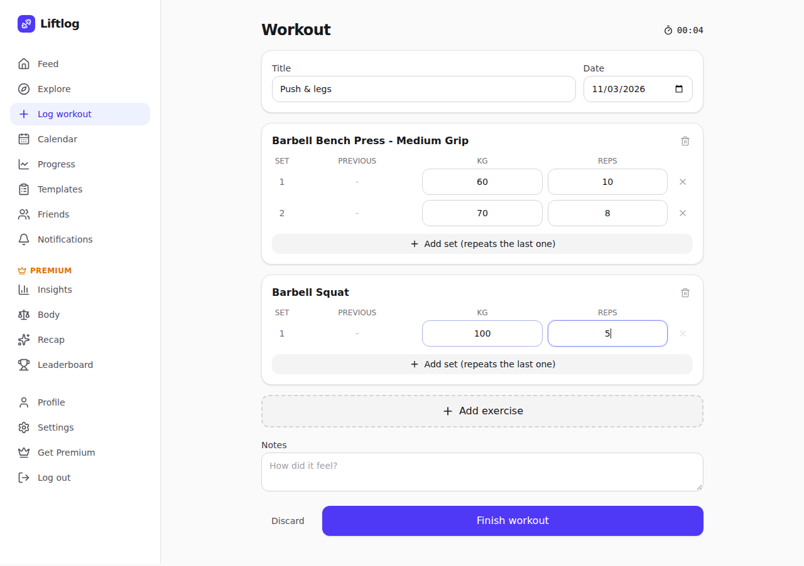
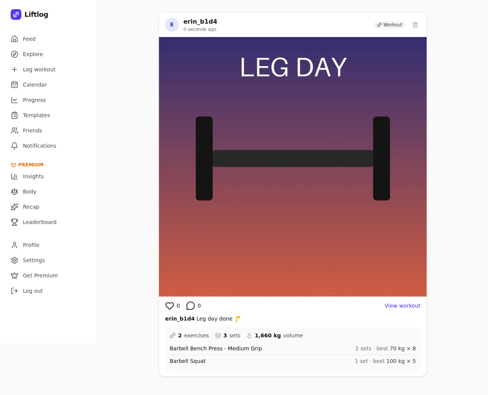
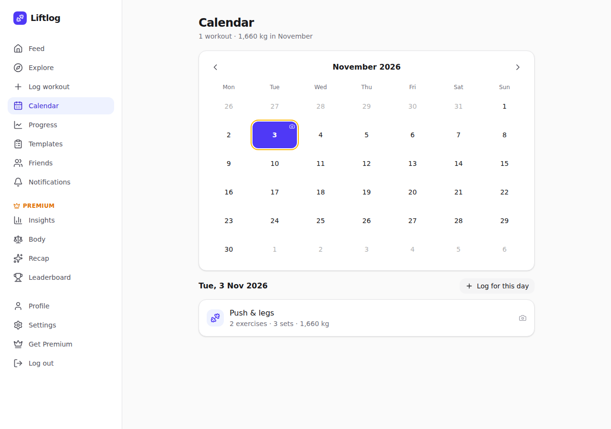
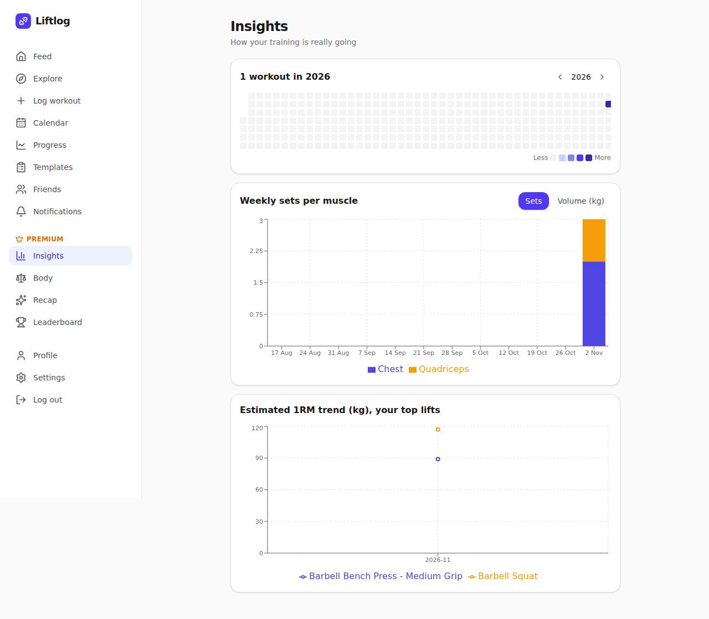

# Liftlog

**Liftlog is a workout tracker with an Instagram-style social feed.** Log every set you
lift, see your training on a calendar, beat your personal records, and share workout
photos with friends. Private accounts are shown only to friends; public accounts appear
on Explore. A Premium subscription (Stripe) unlocks analytics, body metrics, recaps and
friend leaderboards.

It was built as the application for a DevOps course assignment: a realistic, multi-component
stack that is provisioned automatically with Vagrant and cloud-init.

| Logging a workout | The shared post |
|---|---|
|  |  |
| **Training calendar** | **Premium insights** |
|  |  |

## Stack

| Component | Technology |
|---|---|
| HTTP server / reverse proxy / TLS | Nginx |
| Frontend | React 19 single-page app, built with Vite 8 (Tailwind CSS, React Router, TanStack Query, Recharts) |
| Application server | Django 5.2 LTS + Django REST Framework on Gunicorn |
| Database | PostgreSQL (with `pg_trgm` for fuzzy search) |
| Cache / sessions / rate limits | Redis |
| Payments | Stripe (test mode), or built-in demo billing |
| Observability | JSON logs with request IDs, Prometheus `/metrics`, `/api/health/` |

## Features

- **Workout logging**: 876-exercise catalogue with typo-tolerant search, custom exercises, per-set weight × reps,
  "last time" hints, timer, drafts that survive a page refresh, kg or lb.
- **Calendar** of your workouts; workout detail with automatic **personal-record** detection.
- **Share flow**: finish a workout → add a photo and caption → a post with an auto-generated stats card.
- **Social**: feed (you + friends), Explore (public accounts), profiles, likes, comments, notifications.
- **Friends** with mutual requests; posts of private accounts are visible only to friends.
- **Progress charts** per exercise and **workout templates** pre-filled with your last weights.
- **Security**: Argon2 passwords, Redis-backed sessions, CSRF protection, rate limiting + account lockout,
  optional **two-factor authentication** (TOTP + recovery codes), password reset by email, signed and expiring
  photo URLs, photo metadata (GPS) stripped, GDPR data export and account deletion.
- **Premium** (Stripe Checkout + webhooks + billing portal): training heatmap, weekly volume per muscle,
  1RM trends, all-time progress, body metrics, monthly/yearly recap cards, weekly friend leaderboards and challenges.

## Documentation

- [docs/APP.md](docs/APP.md): architecture, security model, how the main mechanisms work, API, commands, local development
- [docs/deploy/DEPLOY-NOTES.md](docs/deploy/DEPLOY-NOTES.md): everything a server needs, step by step
- [docs/deploy/](docs/deploy/): tested reference configs (Nginx site, systemd units, environment file)

## Quick start (local development)

Needs Python ≥ 3.12, Node ≥ 20.19 and PostgreSQL + Redis (via Docker or apt).

```bash
make services                 # PostgreSQL + Redis in Docker (or: make services-apt)
make setup                    # Python venv + pip, npm ci
make migrate seed-exercises   # tables + exercise catalogue
make backend                  # terminal 1: Django on :8000
make frontend                 # terminal 2: open http://localhost:5173
```

Run `make help` for all targets.
